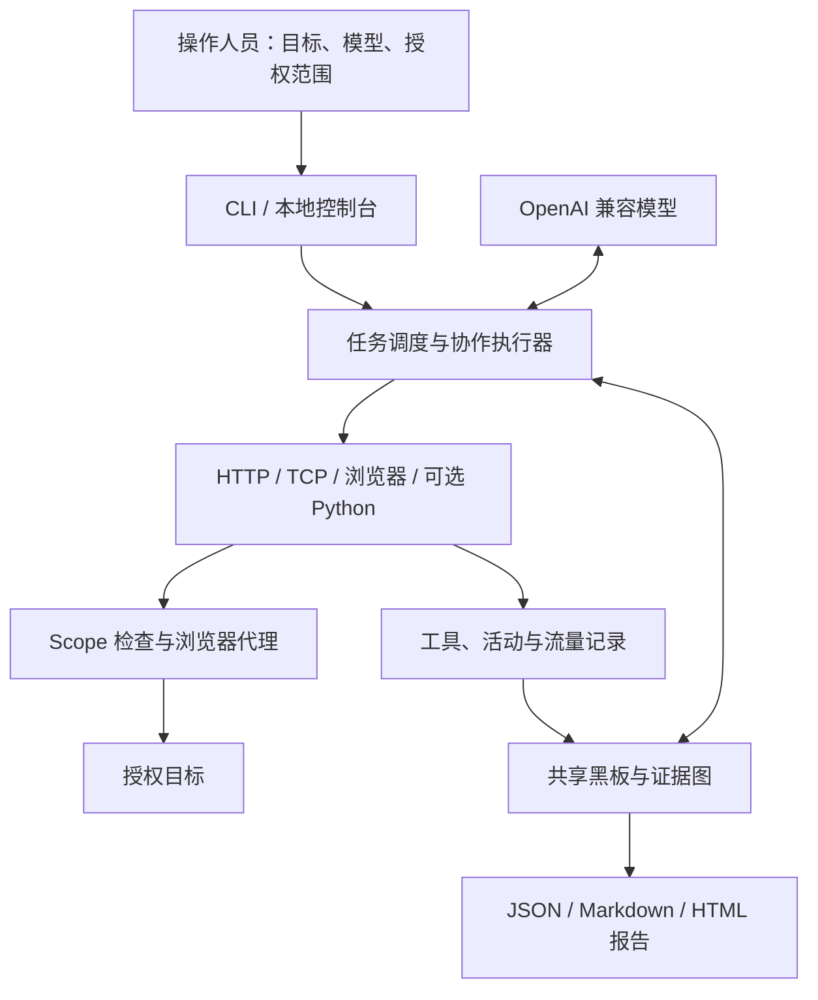

# Chronos

**面向授权安全评估的 Agent 执行系统：让模型自主探索目标，用真实流量支撑发现，并保留完整的任务记录。**

Chronos 以 Go 实现任务调度、工具执行、共享黑板与本地控制台。Agent 可以调用 HTTP、TCP 和 Playwright MCP 浏览器探索授权目标，把观察、发现和待验证的问题持续写入黑板，再通过证据图记录结论与反驳之间的关系。

项目同时支持独立的授权评估任务和评测平台接入。TSecBench 是内置的平台适配器；独立评估无需接入该平台。多个执行器可以使用不同的 OpenAI 兼容模型，在同一任务中共享进展。

## 演示视频

[查看或下载项目演示视频（MP4）](docs/media/chronos-demo.mp4)

## 设计亮点：以证据论证图计算结论

Chronos 将探索中产生的主张、证据、验证与反驳组织为一张**可废止的证据论证图**。它同时保存结论的来源，并为当前判决提供可计算的依据。核心设计包含三个部分：

1. **判决由图规则计算。** 主张的 `confirmed`、`suspected` 或 `refuted` 状态由证据与反驳关系共同决定。Agent 提交观察、证据引用和论证关系，程序据此计算状态；后续反驳可以改变已有判决。
2. **证据可追溯到真实交互。** 普通主张需要 `proof` 或 `verification` 角色的已捕获流量（`[traffic tN]`）作为确认依据；平台验证通过的 Flag 可使用 oracle 证据。报告保留证据引用、复现步骤和验证记录，便于复核。
3. **通用执行内核支持协作扩展。** 执行器使用统一的工具、Scope 约束和共享黑板。操作人员可以选择模型、配置多个同构执行器，并通过有界子任务分配调查工作；执行循环不预设固定攻击剧本。

这让判决具备三个可核查的属性：**同一份图和规则得到一致的判决**；报告导出完整 `evidence_graph`，可沿关系追溯原因；验证与反驳追加保存，保留结论被修正的过程。模型仍参与证据选择和观察解读，程序的确认规则也需要结合实际复现结果审查。具体判决见 [证据图如何判断结论](#证据图如何判断结论)，完整规则见 [证据图实现契约](docs/evidence-graph.md)。

## 本次优化

| 能力 | 当前行为 |
| --- | --- |
| 自动浏览器探索 | 有授权范围时，执行器自动启动隔离的 Playwright MCP / Chromium，获得导航、页面快照、点击和输入等工具。 |
| 可废止证据图 | 将事实主张、发现、反驳、验证与流量证据关联；结论随证据和反驳关系重新计算，可追溯判决原因。 |
| 任务历史 | 按独立运行 ID 保留任务索引、授权范围、公开活动、黑板、流量与报告；重新打开控制台后仍可查询。 |
| 授权范围切换 | 先停止旧执行器，再为新范围创建独立任务，避免混用不同目标的结果和会话。 |
| 暂停与继续 | 在模型请求、工具执行、子任务推进和后台摘要的安全边界暂停；界面区分“暂停中”和“已暂停”。 |
| 长任务恢复 | 对话和运行检查点落盘，支持同一任务的执行器恢复、上下文压缩、黑板增量重注入与有界会话接力。 |
| 模型与审计 | 支持操作人员选择模型、配置备用模型链、查看用量与工具审批，并归档任务产物。 |

## 设计思路

Agent 的执行循环是“观察目标 → 形成主张 → 记录证据 → 继续验证”。Chronos 提供通用工具和运行约束，不为每类目标预设固定攻击流程。

共享黑板保存四类主要信息：

- **Fact**：对目标状态的事实主张，以及可引用的观察和证据。
- **Finding**：值得报告的问题，包含影响目标、严重度、复现步骤与证据引用。
- **Goal / Sub-goal**：仍需调查或验证的目标，用于持续追踪覆盖范围。
- **Verification / Challenge**：独立复现记录与反驳主张，用于修正已有结论。



HTTP 和 TCP 的真实请求、响应会获得 `[traffic tN]` 引用。浏览器用于理解页面和交互流程；重要发现仍需要通过 `http_request` 等工具重放，获得可引用的流量证据。

## 快速开始

以下命令在项目根目录执行。

### 1. 准备环境

| 依赖 | 用途 |
| --- | --- |
| Go | 构建核心程序；版本以 `go.mod` 为准，当前指定 `go1.26.10` 工具链。 |
| Node.js 与 `npx` | 启动 Playwright MCP；当前 Playwright 依赖要求 Node.js ≥20。托管镜像和前端 CI 使用 Node.js 22。 |
| Playwright Chromium | 提供浏览器探索能力。 |
| Python 3 | 仅在显式启用 `run_python` 时需要；默认关闭。 |

安装与当前 MCP 包匹配的 Chromium：

```bash
npx --yes playwright@1.64.0-alpha-1790635538000 install chromium
```

Chronos 固定使用 `@playwright/mcp@0.0.83`。默认由 `npx` 在首次启动时取得该包；也可预先安装，并通过 `CHRONOS_PLAYWRIGHT_CLI` 指定其 `cli.js`，通过 `CHRONOS_PLAYWRIGHT_NODE` 指定 Node 可执行文件。

### 2. 构建并打开控制台

```bash
go build -o chronos ./cmd/chronos
./chronos --engagement examples/engagement.example.json --web
```

打开 <http://127.0.0.1:8000>。示例配置中的目标用于说明格式，请先在控制台填写你实际拥有授权的范围，配置模型，再点击“继续”。带 `--web` 的独立评估默认暂停启动；空授权范围不会执行目标网络请求。

模型可以直接在控制台设置，也可以通过环境变量或 `.env` 配置：

```bash
cp .env.example .env
# 编辑 .env，填写实际使用的模型配置。
```

`.env` 已被 Git 忽略。进程环境变量优先于 `.env`。

### 3. 使用自己的任务配置

将下面的内容保存为仓库外的本地 JSON 文件，替换示例目标与任务说明：

```json
{
  "name": "authorized-assessment",
  "mode": "assessment",
  "goal": "评估授权测试环境，记录可复现的问题与证据。",
  "scope": {
    "targets": ["https://app.example.test"],
    "rules_of_engagement": "仅限所列目标；禁止拒绝服务、暴力破解以及破坏性数据修改。"
  }
}
```

```bash
./chronos --engagement /path/to/engagement.json --web
```

不使用控制台时，必须预先填写非空 Scope，并配置可用模型。独立评估默认不限时，可通过任务 JSON 中的 `time_budget_seconds` 或 `--time-limit` 显式设置墙钟预算。

## 模型配置与协作

Chronos 支持提供工具调用能力的 OpenAI 兼容接口，可配置 Base URL、模型 ID、API Key 和上下文窗口。接口兼容性及具体工具调用效果取决于实际模型服务。

单模型可以在控制台配置。需要多个独立执行器时，参考 [模型配置示例](examples/models.json)，填入真实模型信息，并优先通过 `api_key_env` 引用环境变量：

```bash
./chronos --engagement /path/to/engagement.json \
  --models-file /path/to/models.json --web
```

`name` 是执行器标识；`provider` 是显示名称，不限制供应商；`model` 是发送给接口的真实模型 ID。示例中的模型 ID 和端点是占位符，需要替换。`--models-file` 与 `--model` 二选一。

多个执行器在同一任务内共享黑板和证据。修改目标状态前，通过 `claim_surface` 租约协调操作；需要独立调查时，可使用受深度、数量和步数预算约束的 `delegate` 子任务。子任务继承或收窄父任务的授权范围。

可为执行器显式配置 `fallbacks` 备用模型链。模型故障恢复、上下文压缩和请求重试规则见 [Harness 设计](docs/harness-design.md)。

## 控制台与任务生命周期

| 操作 | 行为 |
| --- | --- |
| 暂停 | 立即设置暂停请求；当前模型请求或工具可以完成，后续步骤在安全边界等待。 |
| 继续 | 唤醒暂停的执行器，沿原会话继续处理。 |
| 停止 | 取消当前执行任务。 |
| 发消息 | 将消息加入所选执行器的原会话，在后续处理边界读取。 |
| 修改授权范围 | 范围变化时创建新的运行 ID，旧任务记录保留。 |
| 查看任务历史 | 查询当前及历史运行的发现、事实、证据图、活动与流量。 |
| 查看事实与图谱 | 沿证据、支持、反驳、验证和来源关系追溯结论。 |

暂停期间，已配置的墙钟预算仍继续计时。聊天消息不能扩大 Scope，范围变更必须通过控制台的授权范围设置完成。

控制台仅接受 loopback 监听地址，默认 `127.0.0.1:8000`，当前没有多用户登录与远程访问管理。

## 证据图如何判断结论

证据图包含 `grounds`、`supports`、`refutes`、`verifies` 和 `derived_from` 关系。结论由程序根据证据和反驳计算，Agent 不能直接把任意发现改写成“已确认”。

- `proof`、`verification` 流量可以为主张提供确认依据；`baseline`、`supporting` 保留关联信息。
- 平台验证通过的 Flag 使用 `oracle:<finding-id>` 作为确认依据；没有平台 oracle 时，记录 Flag 本身不会自动确认结论。
- `supports` 表达论证关联，不代替该结论自身的证据要求。
- 有证据的反驳可以推翻结论，反驳本身也可以被后续证据推翻。
- 存在未解决冲突时，结论保留为 `suspected`，必要时创建裁决子目标。
- 验证尝试追加记录，保留原始证据；复现步骤需要编号和 `Expected:` 成功判据。

| 图上的证据与反驳状态 | 当前判决 |
| --- | --- |
| 自身有确认依据，且没有反驳或全部反驳已被驳回 | `confirmed` |
| 存在已确认且有证据支撑的反驳 | `refuted` |
| 其余情况：缺少确认依据，或仍有未解决的冲突与反驳 | `suspected` |

普通发现会创建验证子目标；有可用协作者时优先分派给其他执行器，单执行器时可由原执行器复现。已有 `proof` 的发现可能在验证子目标完成前满足 `confirmed` 规则，图判决与验证完成情况需要分别查看。

图判决分为 `confirmed`、`suspected`、`refuted`，控制台与报告会展示判决依据。`confirmed` 表示满足当前程序的证据规则，报告使用者仍应复核证据与复现结果。完整规则见 [证据图实现契约](docs/evidence-graph.md)。

## 数据保存与恢复

`CHRONOS_STATE_DIR` 指定运行数据目录，默认 `.chronos-state/`：

```text
.chronos-state/
├── blackboards/       # 事实、发现、子目标与证据图
├── traffic/           # HTTP / TCP 流量日志
├── sessions/          # 执行器会话日志与运行检查点
├── subagents/         # 子任务会话与元数据
├── run-history/       # 每次运行的生命周期索引
├── activities/        # 公开活动流
├── scopes/            # 操作人员保存的授权范围
├── engagement/        # 独立任务恢复信息
├── scheduler/         # 平台调度恢复信息
└── reports/           # 报告、逐次运行产物与归档
```

正常完成后再次启动会创建新的运行；中断恢复使用原运行 ID。切换目标范围时，新任务的黑板、流量和会话与旧任务隔离。

重启时，未完成工具调用会记录“结果未知”，不会自动重放。历史版本没有保存的活动事件无法补回，但留下的黑板、流量和报告可以被历史列表识别。子 Agent 的原会话续跑目前限于同一进程。

轻量模型用量写入 `llm_usage.jsonl`；启用 `LLM_RECORD=true` 后保存完整模型请求与响应。模型配置、目标返回的数据和会话记录可能包含敏感信息，运行目录应按任务资料保管，不提交到公开仓库。

每次独立任务可产出 JSON、Markdown 和 HTML 报告，并生成按 SHA-256 关联内容的 `archive.tar.gz`。升级程序时应保留运行数据目录；容器部署需要将其映射到持久化存储。

## 授权范围与工具管控

Scope 支持主机名、IP、URL 和 CIDR。URL 条目按主机匹配，不按路径限制；空范围拒绝目标出网。HTTP、TCP 和可选 Python 工具使用范围检查，浏览器导航及其代理也读取当前 Scope。

Python 网络护栏和浏览器代理用于约束正常工具行为，不构成操作系统级沙箱。`run_python` 默认关闭，启用时应在已有隔离的运行环境使用。

可通过 `CHRONOS_TOOL_RULES_FILE` 设置 `allow` / `deny` / `ask` 规则，参考 [工具规则示例](examples/tool-rules.json)。需要确认的工具调用在控制台逐次审批，超时拒绝；批准不能扩大 Scope。规则决定与审计写入本地记录。

## 平台接入与部署

独立评估使用 `--engagement`，无需平台令牌。默认调度器模式使用内置 TSecBench 适配器：

```bash
./chronos --web
```

平台模式需要填写模型配置、`BENCHMARK_BASE_URL` 和 `BENCHMARK_TOKEN`。调度器负责轮询、并发窗口、重试和预算控制；当前平台任务并发上限为 3。接入其他平台时，实现 `platform.Platform` 并注册适配器。

[Dockerfile.tsecbench](Dockerfile.tsecbench) 面向 TSecBench 托管运行，包含 Go 程序、Python、Node.js、Playwright MCP 和 Chromium，默认不启动 Web 控制台。镜像打包、离线预检和托管配置见 [TSecBench 接入说明](docs/tsecbench-hosted.md)。

控制台前端已静态导出并嵌入 Go 二进制，部署时不需要额外启动 Next.js 服务。修改 Go 代码后重新构建；修改前端后，应先生成并同步静态资源，再构建 Go 程序。发布更新宜安排在任务空闲时，并保留可回退的程序版本与运行数据备份。

## 开发与验证

核心检查：

```bash
go test ./...
go test -race ./...
go vet ./...
go build ./...
```

修改前端后，在项目根目录执行：

```bash
(cd web && npm ci && npm run build)
rm -rf internal/web/dist
cp -R web/out internal/web/dist
go build -o chronos ./cmd/chronos
```

`internal/web/dist` 是构建产物，随源码版本保存；`web/out`、`web/.next` 和 `web/node_modules` 已被忽略。开发界面可在 `web/` 执行 `npm run dev`，开发代理把 API 请求转发到本机 `8000` 端口。

安装浏览器运行时后，可单独执行本机测试页面上的浏览器验证：

```bash
CHRONOS_BROWSER_SMOKE=1 go test ./internal/browsermcp \
  -run TestPlaywrightBrowserSmoke -count=1 -v
```

项目已有真实授权任务的实测使用记录。自动化测试覆盖 Scope、证据图、会话恢复、任务历史、暂停控制、模型故障与报告等模块；默认测试不自动调用真实模型或目标。实测报告和任务数据保存在本地，不随源码公开，也不据此宣称统一的漏洞发现率或平台得分。

## 代码与文档导航

| 路径 | 内容 |
| --- | --- |
| `cmd/chronos/` | 程序入口、配置加载与运行方式选择 |
| `internal/solver/`、`internal/swarm/` | 模型工具循环、协作、子任务、暂停与恢复 |
| `internal/blackboard/`、`internal/traffic/` | 黑板、证据图与真实流量记录 |
| `internal/scope/`、`internal/guard/` | 授权范围与工具审批 |
| `internal/browsermcp/` | Playwright MCP 进程和浏览器代理 |
| `internal/llm/`、`internal/llmconfig/` | 模型配置、密钥池与备用链 |
| `internal/runhistory/`、`internal/report/` | 任务历史、报告与归档 |
| `internal/platform/`、`internal/scheduler/` | 平台适配与任务调度 |
| `internal/web/`、`web/` | 控制台后端与 React / Next.js 前端 |

更多配置见 [.env.example](.env.example)，实现背景见 [Go 实现说明](docs/go-port.md)、[Harness 设计](docs/harness-design.md) 和 [任务模型](docs/mission-modes.md)。
