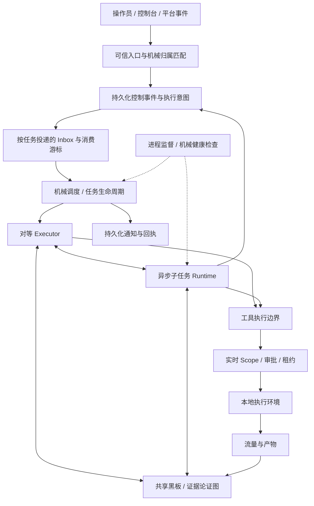

# Chronos Harness 优化方案：从同步会话走向可恢复的事件执行

方案日期：2026-10-31；实施更新：2026-11-01。状态：**核心改造已在工作区实现，异步模式默认关闭；托管扩展和质量评测待后续验证**。

实施结果与操作说明见 [Harness 运行与恢复](../harness-runtime.md)。以下方案保留原设计目标；不等于每个扩展方向都已实现。

| 批次 | 当前结果 |
| --- | --- |
| A | 已实现持久化故障阻止新动作、严格版本检查、单写者锁和耐久快照；补充错误及进程测试。 |
| B | 已实现按执行器记录的控制日志、执行意图/边界与请求指纹、通知 Outbox；黑板仍独立持久化，没有重写成事件溯源系统。 |
| C | 复用会话日志实现固定事件 ID 的幂等 Inbox、来源标记与背压；未增加独立消息中间件。 |
| D | 已实现可选异步子任务、预算账本、完成结果恢复、跨接力交付；崩溃中的子任务保守停在待核对状态，不自动续发未知动作。 |
| E | 已实现按 ID 读取、索引分页与有界邻居展开；不提供任意历史版本读取。 |
| F | 已实现健康观测、模型调用超时、进展影子指标和故障提示；自动语义监督干预等待评测，不在本轮开启。 |
| G | 提供进程监督部署示例；远程 runner、后台 Python 和云端/本地拆分仍按需求另立项。 |

审计基线：`chronos-repo` 的 `a9f2a12`，主实现为 Go。本文基于代码静态核查；未运行真实目标任务，文中的性能门槛都是建议验收值，不是已取得的收益。

## 1. 建议与资料边界

建议保留 Chronos 的“机械调度 + 对等执行器 + 共享黑板 + 证据图”主干，按以下顺序演进：

**持久化错误显式处理 → 持久化事件与投递 → 异步子任务及跨进程恢复 → 按 ID 召回 → 分层监督 → 按需求拆分执行环境。**

这轮优化的目标是：操作员能随时输入、耗时支线不阻塞主线、崩溃后能解释并恢复工作、每个结论仍能追到真实证据。架构收益用完成质量、恢复正确性和人类干预成本衡量。

用户提供的是 [《Super-agent 设计探索：迈向更自主的 Agent 系统》微信链接](https://mp.weixin.qq.com/s/zoS7GlReWPhfCjENGxXCdg)。本次访问触发微信环境验证，**未取得原文完整正文**。已核查对应的 DeepSeek 官方原型及其文档，以下只把官方一手资料可核实的机制作为借鉴依据；文章中的完整实验、Watchdog、云端与本地解耦等细节，不当成原型已实现的事实。

官方 [原型 README](https://github.com/deepseek-ai/dsh-superagent-prototype) 明确区分研究原型、内部版本与文章设计，部分设计仍属未来方向。本次核查的原型提交为 `6337fc823ce20251c8de8085948165c81aaa701e`。

| 官方资料中可核实的机制 | 对 Chronos 的适配判断 |
| --- | --- |
| Trigger / Thread / Subscription 把后续输入送到已有任务；新工作另行准入。[领域模型](https://github.com/deepseek-ai/dsh-superagent-prototype/blob/6337fc823ce20251c8de8085948165c81aaa701e/docs/001-domain.md) | 借鉴“已知归属直接投递”；Chronos 的 `run_id/task_id` 通常已经明确，无需每次模型路由。 |
| 工作先持久化再执行，重启补交未消费输入。[执行契约](https://github.com/deepseek-ai/dsh-superagent-prototype/blob/6337fc823ce20251c8de8085948165c81aaa701e/docs/003-execution.md) | 优先补齐事件、子任务及通知的恢复语义。 |
| Store、Effects、Outbox 分开承担状态、待执行工作和发送回执。[架构说明](https://github.com/deepseek-ai/dsh-superagent-prototype/blob/6337fc823ce20251c8de8085948165c81aaa701e/docs/007-architecture.md) | 借接口与提交顺序；第一版沿用 Go 与文件存储，不引入其框架。 |
| 输入的来源与工作授权分别处理。[授权契约](https://github.com/deepseek-ai/dsh-superagent-prototype/blob/6337fc823ce20251c8de8085948165c81aaa701e/docs/002-authorization.md) | 事件携带来源，Scope 仍由可信控制面设置；收到目标内容不等于获得指令。 |
| 只在结果可用或人必须行动时打扰人。[设计原则](https://github.com/deepseek-ai/dsh-superagent-prototype/blob/6337fc823ce20251c8de8085948165c81aaa701e/docs/000-philosophy.md) | 保留完整审计流，控制台默认聚焦待决事项和有效进展。 |

**本文后续的优先级、数据结构、监督指标和实施批次，是针对 Chronos 的独立设计建议。**

## 2. 当前基础与真实缺口

10 月 25—27 日的设计已经大部分落地，不能再按旧方案表格把它们列为待开发。当前也已有 Playwright MCP 浏览器能力；历史文件里的“0 MCP”不是准确的现状描述。约束应以当前实现及正式契约为准。

| 能力 | 已有实现 | 本轮应补的部分 |
| --- | --- | --- |
| 上下文管理 | [solver.go](../../internal/solver/solver.go)、[context_budget.go](../../internal/solver/context_budget.go)：动态预算、压缩、每轮摘要、轮内黑板增量 | 被摘要省略的黑板记录缺少统一的按 ID 读取工具；事件消费游标需要持久化。 |
| 并行协作 | [batch.go](../../internal/solver/batch.go)：受限 HTTP 并发、同批 delegate 并发；[leases.go](../../internal/blackboard/leases.go)：修改面租约 | 一批调用仍等待全部结束，父执行器不能在子任务运行时继续下一轮。 |
| 子任务 | [delegate.go](../../internal/solver/delegate.go)：隔离窗口、深度/数量/步数预算、元数据及会话落盘 | `toolDelegate()` 直接返回 `runChild()`；`delegate_resume` 查进程内 `children` 及 `solver` 指针，没有启动扫描重建。 |
| 恢复 | [session.go](../../internal/solver/session.go)：JSONL、`fsync`、半条尾记录处理、未知工具结果占位；[runtime.go](../../internal/swarm/runtime.go)：运行检查点 | 各存储缺统一关联与对账协议；异常读取与写入的处理不够严格。 |
| 操作员输入 | [solver.go](../../internal/solver/solver.go)：队列落盘，在工具结果配对完成后注入 | 缺事件 ID、显式消费回执、优先级与持久化背压；同步长调用期间仍需等待。 |
| 停滞与停止 | [termination](../../internal/termination/termination.go)、[swarm.go](../../internal/swarm/swarm.go)：pivot、安静周期、覆盖终止、饱和接力 | 进展主要按记录数量增长衡量，缺重复观察和验证质量维度。 |
| 判决与证据 | [graph.go](../../internal/blackboard/graph.go)：可废止判决；独立验证子目标、真实流量引用 | 应作为优化的质量约束，不另加一个模型来覆盖图判决。 |
| 通知与活动 | [activity.go](../../internal/swarm/activity.go)、[notify.go](../../internal/notify/notify.go)：活动落盘、Webhook 去重 | 活动是展示记录，不能直接当可靠任务队列；发送与本地记账间存在崩溃窗口。 |

三个优先处理的代码事实：

1. `solver.go` 的 `journal()` 写失败后只打印日志；`start()` 读失败后把 `sessionPath` 清空并继续。对要求可审计的任务，应进入明确的存储故障状态。
2. `delegate.go` 的 `toolDelegate()` 同步等待子执行循环。并发 delegate 批次已经存在，但父会话仍在等待整批完成。
3. `blackboard.go` 的 `ProgressMarker()` 为 `facts + findings + promoted` 数量。新建重复事实也可能增加该值，因此它不足以代表有效发现进展；这是静态分析得到的风险，尚未用真实任务测出发生频率。

## 3. 目标架构与不变量



初期仍是一个 Go 进程；图表示职责边界，不要求引入消息中间件、服务集群或插件系统。

应持续满足的约束：

- `run_id` 对应一次独立授权运行；会话、任务、工具、流量与通知都携带它。新 Scope 继续沿用“停止旧运行，创建新 run”的规则。
- `task_id` 表示持续工作，`executor_id + generation` 表示某次接手者；换窗口不会遗失工作身份。
- 调度器决定容量、归属、生命周期；模型决定调查方法。执行器保持中性，不增加固定侦察、攻击、裁判角色。
- 工具执行前检查当前 Scope、规则与有效租约。历史批准和事件上下文都不能扩权。
- 一次工具调用恰有一个协议结果。异步完成通过新事件投递，不能补第二条同 `tool_call_id` 的结果。
- 原始证据与黑板判决继续按现有契约保存。模型摘要、诊断建议和任务完成回报不等于漏洞已确认。
- 明确区分暂停、等待事件、完成、失败和执行结果未知；暂停不改变已有墙钟预算语义。

## 4. P0：先把恢复与执行边界做实

### 4.1 持久化故障不能静默降级

改造 `Solver.start/journal` 和运行检查点加载，区分首次运行文件不存在、日志损坏、未知版本、权限错误、磁盘写满。

- 新任务正常创建；已存在任务恢复失败时进入 `storage_error`，保留原文件和错误位置。
- 关键事件提交失败后，不再发起新的模型请求或工具动作；对已经在途的动作做取消与对账，无法判断的记为 unknown。
- 状态更新先持久提交，再对调用方返回已接受。不能只把消息放进内存就向控制台确认成功。
- 有效版本执行显式迁移；新版本记录拒绝被旧程序静默当作空状态读取。`swarm.loadRuntime()` 当前的异常返回零值行为也要纳入改造。
- 状态目录增加操作系统级单写者锁；原子快照使用临时文件、同步、替换及目录同步，并针对支持的操作系统验证。

首个可独立合入的改动应是这部分，收益不依赖异步化。

### 4.2 增加小型持久化控制事件协议

建议新增 `internal/runevent`，使用 Go 标准库实现**单写者、仅追加日志、可重建控制状态快照**。先服务任务状态、消息投递和待执行工作。

事件信封最小字段：

```json
{
  "schema_version": 1,
  "run_id": "run-...",
  "seq": 42,
  "event_id": "evt-...",
  "kind": "child.completed",
  "task_id": "task-...",
  "executor_id": "executor-...",
  "generation": 2,
  "causation_id": "evt-...",
  "source": "runtime",
  "payload_ref": "artifact-..."
}
```

日志中的一条已同步记录是一次控制状态转换的提交点，快照只是缓存；重放控制事件时不执行网络动作。大正文走产物引用，避免频繁复制整个模型窗口。检查点记录 `last_applied_seq`，事件和命令分别去重。

**第一版不把整个黑板、流量、会话重写成事件溯源系统。** 黑板仍是领域状态的权威存储；新日志管理控制状态。跨存储关联写明 `bb_revision`、会话位置和产物 ID，在启动时对账，不能宣称多个文件具备原子事务。需要全量重建黑板时，再设计领域事件与迁移。

### 4.3 执行意图与副作用分开

每个工具动作有稳定 `action_id`，按以下顺序处理：

`intent 已持久化 → 执行前校验 → started → 外部动作 → 证据落盘 → result 已持久化`。

崩溃可能发生在任意两步之间。没有 result 的动作进入 `unknown`，先检查已有流量与目标状态，**不自动重发**。HTTP 方法只能辅助分类，不能凭 GET 名称保证没有副作用。

待执行工作只重试能证明尚未开始的动作，或由适配器明确支持幂等的动作。网络副作用无法仅靠本地日志获得 exactly-once 保证。

通知使用持久化 Outbox：记录待发送事件，发送后落回执；下游支持时传稳定幂等键。当前 Webhook 发送成功与 `notifications.json` 写入之间的崩溃可能导致重复发送，因此对外说明为至少一次交付加接收端去重。

**P0 验收：** 写满磁盘后任务显示存储故障；坏版本不被当成新任务；两个进程不能写同一运行；外部动作后、结果记账前强杀进程，重启不自动重发该动作；损坏尾记录和中间损坏能被区分。

## 5. P1：事件直达、异步子任务与恢复

### 5.1 把现有输入队列升级为持久化 Inbox

建议新增 `internal/inbox`，复用现有安全边界注入逻辑。

- 以 `run_id/task_id` 路由操作员消息、子任务结果、验证分配、黑板变更通知；已知归属直接投递。
- 显式选择的执行器仍可收到定向消息；Scope 变更继续走可信控制面。
- 记录 `queued → applied`：applied 表示输入已进入持久化会话，**不表示模型已理解或工作已完成**。模型请求、回报另有因果关联。
- 完成标记和消费游标通过幂等恢复协议对齐；重复投递只在会话里生效一次。崩溃在注入前后都不能丢消息。
- 队列有上限、大小配额和背压。黑板修订通知可合并为“读取到 revision N”；用户指令和唯一子任务完成结果不能丢弃。
- stop/cancel 是独立控制信号，立即请求取消；普通输入在工具调用与结果配对完成后注入。关键通知单独保留容量。
- 无新事件时允许 `waiting_event`，由事件唤醒，避免执行器为“看看子任务好了没”持续调用模型。

外部触发器以后按“事件产生 → 去重与准入 → 已知任务投递”接入。第一版不增加 LLM Router；遇到确实无法确定归属的多渠道需求，再在入口侧单独评估语义归属，不改机械 scheduler。

### 5.2 把 delegate 从同步工具改成有生命周期的 Job

建议新增 `internal/taskruntime`，先只承载子执行器。

工具面建议：`delegate_start`、`delegate_status`、`delegate_cancel`。已有 `delegate` 暂保留同步兼容；`delegate_resume` 逐步转到持久化任务身份。状态读取默认不阻塞，完成靠事件唤醒。

```text
queued → running → completed / failed / cancelled
             ↘ interrupted → recovering → running / needs_reconciliation
```

启动顺序：分配稳定 child ID、提交预算预留与启动意图、返回 `started` 工具结果，再由 runtime 启动。子任务结束后提交结果引用，投递 `child.completed`。父执行器可在子任务运行期间继续处理其他方向。

必须一并解决的边界：

- Job 挂在 mission 级生命周期下；父回合结束不应误取消它，mission 停止和 Scope 切换必须停止它。
- 单个 Solver 只能有一个执行循环操作消息窗口；异步化并发发生在不同 Solver 之间。
- 保留深度、子任务数和步数限制，增加运行级统一预算账本。预留、消耗、归还均持久化，重启或并发分支不能重复发放预算。
- 首版并发不提高现有上限；暂停时停止派发，已有调用按当前暂停契约停在安全边界。
- 子任务的租约独立持有；不得依靠父任务旧租约跨越 Scope 或代次。
- 尚有运行中子任务、待处理输入或未知副作用时，不能判定整个任务自然完成。
- 父执行器接力时，完成结果按 `task_id` 送给新 generation；不能留在已经退出的旧对象上。
- 晚到结果可写入其原 run 的历史，不能唤醒已取消任务或污染新 Scope 的运行。

首版只异步化已有 delegate。`run_python` 的后台进程生命周期、输出配额、子进程回收和操作系统隔离另立一批；不能直接把 60 秒限制改成无限后台运行。

### 5.3 跨进程恢复子任务

当前 child metadata 没有重建入口。新增启动扫描与恢复器，保存并核对：`run/task/parent/child ID`、generation、Scope 指纹、模型引用、会话路径、预算账本位置、状态、最后事件与结果引用。凭据仍通过配置引用解析。

恢复规则：

- queued 且未开始：在预算和 Scope 校验后派发。
- 已完成但结果未消费：补投递一次逻辑结果，不再执行子任务。
- 原来 running：标记 interrupted，重建会话，补齐未知工具结果，完成副作用对账后再续跑。
- 浏览器进程和认证会话丢失：明确标出环境不可恢复部分；允许重建浏览器，但不能声称原环境无损恢复。
- 模型配置缺失、Scope 不匹配、父任务被停止：进入明确的待处理状态，不擅自换身份或扩大范围。

**P1 验收：** 运行两个耗时子任务时父执行器仍能开始下一轮；输入重投递十次只注入一次；完成后、消费前强杀可补交结果；接力后仍收到旧 generation 子任务结果；Scope 切换后旧任务没有新目标请求。

## 6. P2：让上下文成为可读取的视图

现有摘要、冷摘要和流量分页已经是良好基础。进一步把“模型当前看到什么”与“系统保存什么”分开：活动窗口放约束、当前目标和必要变化；详细记录存于窗口外，并提供稳定入口。

建议新增一个只读工具 `artifact_get`：

```text
artifact_get(kind, id, revision?, offset?, limit?, neighbors?)
```

支持 Fact、Finding、Subgoal、Challenge、Verification、Digest、TaskResult；已有 `traffic_get/search` 保留。沿现有 `from_ids`、图边、验证和流量引用进行有界展开，不引入向量库和跨任务记忆。

- 返回原始记录、当前判决、修订号及引用；摘要不能取代原证据。
- 支持按类型、ID、目标和创建者的确定性查找，避免模型只知道“还有 80 条记录”却无法找到所需 ID。
- 每次读取记录来源、范围和长度；调用受 run 隔离、分页、总字节与展开深度限制。
- 压缩后的 digest 保留成员 ID，模型能从 digest 找回原始成员。
- 模型请求记录当前模型、工具 schema 指纹、提示版本、注入记录版本和压缩代次。严格请求回放按显式完整记录设置启用；默认只保存必要索引与指纹，不能声称它能还原未保存的正文。
- 工具结果与目标网页标注为不可信来源，即使被摘要或转交，也不升级为操作员指令。以 Scope 和工具边界落实权限，不能只靠提示词防注入。

**P2 验收：** 早期低优先级记录被摘要省略后，执行器能按 ID 找回并完成后续验证；越 run 读取被拒绝；冷摘要原成员和反驳路径仍可追溯；上下文溢出率与 token 开销有前后对照。

## 7. P2：从数量型进展走向分层监督

保留 StallPolicy，补充轻量 Supervisor。这个建议不要求复制独立 LLM Watchdog 会话。

第一层在 agent loop 外做确定性健康检查：heartbeat、模型/工具超时、日志提交失败、Inbox 积压、租约占用、等待环和预算异常。另用操作系统服务管理器监督整个进程，覆盖 Go 主进程崩溃与事件循环卡死。

第二层把进展拆成多个可观测信号，初期以影子方式运行，不立刻改变终止策略：

| 维度 | 建议信号 | 防止误判 |
| --- | --- | --- |
| 新信息 | 去重后的目标、请求与响应指纹变化 | 相同内容反复写 Fact 不算新发现；动态字段归一化需用样本校准。 |
| 论证进展 | 新的有效证据接地、独立复现、冲突被裁决 | refutation 也可能是有效进展，不能只奖励 confirmed。 |
| 覆盖进展 | 显式子目标的有证据解决与交接 | 覆盖未知时不声称完整；随意新增或关闭子目标不应刷进展。 |
| 效率与健康 | 重复请求占比、连续空转、单位成本有效产出 | 无发现不等于无价值；排除一条假设也应有记录。 |

第三层仅在持续异常且机械规则不足时，触发一次有预算的模型诊断。输入限于目标、进度摘要、证据 ID 和失败轨迹，输出结构化建议。模型可以建议重读证据、改变调查方向、接力或暂停，不能自行改 Scope、绕过 Guard、确认漏洞或无限重启。

干预动作使用稳定 ID、冷却时间和运行级次数上限，避免“监督器不断重启执行器”。分阶段从仅记录、到提示、再到机械恢复。凡影响判决仍由既有证据图处理。

## 8. P3：执行环境与人机交互的后续演进

### 执行环境

先抽一个窄接口，让 HTTP/TCP、浏览器和 Python 的启动、取消、产物读取有一致标识。提供 Local 实现，保持单机部署；待有真实的跨设备或长期托管需求，再做 daemon 与远程 runner。

远程化的前置条件是执行身份认证、绑定 run 与 Scope 版本的短期权限、网络出口约束、凭据最小化，以及断线后未知动作的对账。执行器代次可以阻止旧客户端继续调度，**不能撤回已经到达目标的请求**。本地也应先验证 Python 的操作系统隔离与子进程回收，不能把 socket monkey patch 当沙箱。

### 操作员界面

默认呈现待审批、需补信息、恢复失败、重要判决变化和完成产物；全部活动保留在可展开的轨迹视图。每条人工问题关联 run、task、原因及可执行操作，避免消息散落在工具日志里。

验证完成、结论被反驳和候选高危发现应区分显示；通知带判决及证据引用。通知去重与消息顺序使用 Outbox，不因为刷新页面或重启再次打扰操作员。

持续在线首先意味着可等待、可恢复。第一版仅响应授权任务内的事件；如果以后增加资产变化自动复测，需单独配置范围、时段、频率、预算与停止条件，先记录“本会启动什么任务”，核对后再启用。收到任意网页内容不能创建新授权任务。

## 9. 实施批次、验证与回退

以下是建议拆分，工作量为单人熟悉代码后的粗估，不是交付承诺；先完成第一批再校准。

| 批次 | 主要改动位置 | 可交付结果 | 估算 |
| --- | --- | --- | --- |
| A / P0 | `solver/session.go`、`solver/solver.go`、`swarm/runtime.go` | 存储故障停止新动作、版本校验、单写者锁、恢复错误可见 | 2—3 人日 |
| B / P0 | 新增 `runevent`，接入 `engrun`、`scheduler`、`notify` | 控制事件提交、执行意图、Outbox、快照与对账 | 4—6 人日 |
| C / P1 | 新增 `inbox`，接入 `queueUser/flushUser` | 幂等投递、消费回执、背压、事件唤醒 | 3—5 人日 |
| D / P1 | 新增 `taskruntime`，改 `delegate.go`、`batch.go`、`swarm`、`termination` | 异步子任务、统一预算、跨进程恢复与接力交接 | 5—8 人日 |
| E / P2 | `blackboard`、`solver/tools.go`、上下文记录 | 按 ID 召回、来源标识、有界图展开 | 2—4 人日 |
| F / P2 | `termination`、新监督模块、控制台 | 进展影子指标、机械健康检查、待处理事项视图 | 3—5 人日 |
| G / P3 | 工具执行边界、部署 | 本地环境接口与隔离；远程 runner 另估 | 按实际需求立项 |

A—D 是本轮主线；E 可在 B 的标识稳定后独立推进。先完成可靠异步闭环，再决定是否需要模型诊断和远程执行。

验证分两组：调度/恢复使用确定性假模型、慢工具与故障注入；发现质量使用相同模型、相同预算的授权本地靶场任务。固定模型版本、提示、配置和任务快照，基线与候选成对重复，报告分布及失败样本。不能把其他系统的合成消息吞吐等同于 Chronos 的发现能力提升。

| 指标 | 建议验收门槛 |
| --- | --- |
| 消息正确性 | 重复、乱序、重启注入场景中逻辑消费不丢不重；控制指令不被普通事件积压阻塞。 |
| 异步启动 | 不含模型推理的本地 `delegate_start` 返回时间 p95 ≤ 500ms；有空余容量时父子可同时推进。 |
| 恢复正确性 | 关键持久化边界逐点强杀；不得自动重发结果未知动作；已完成子任务不重跑。 |
| 恢复时间 | 固定 100MB 日志、20 个子任务、无外部服务等待的夹具，进程就绪至恢复调度 p95 ≤ 10 秒；另报环境重建时间。 |
| 权限与隔离 | Scope 切换、取消、晚到事件、旧 generation、跨 run 读取等用例全部通过。 |
| 预算 | 多子任务、取消与重启后预留和消耗一致，运行级预算不因并发与恢复重复发放。 |
| 有效收益 | 对含独立耗时支线的任务集，目标完成耗时 p95 降低 ≥20%；同时报告模型/工具成本和完成率。 |
| 发现质量 | 独立复现通过率、误报率及有效发现数无明确回退；样本不足时不得宣称质量等价。 |
| 监督效果 | 影子集能识别重复写事实伪进展，且有价值的反驳和慢验证不会被错误终止。 |

实施时每批执行受影响包测试；跨生命周期改动执行 `go test ./...`、`go test -race ./...`、`go vet ./...`、`go build ./...`。核心故障用子进程强杀验证，不能只用内存 mock 证明恢复。

回退策略：异步 delegate 和新监督策略默认关闭，保持旧同步工具兼容；先对新 run 启用。旧日志只读保留，迁移写新代次和清晰版本。旧二进制遇到新状态必须拒绝续跑；回退只用于旧格式任务或新建任务，不能强行用旧程序接管已迁移的活动运行。

## 10. 第一批具体开发清单

1. 将 `start()` 的恢复错误返回到 Swarm，新增可见 `storage_error`；停止清空持久化路径继续运行的隐式降级。
2. 将 `journal()` 改成可传播错误的提交接口，模型请求与工具派发前必须确认所需记录已提交。
3. 为 `loadRuntime()` 区分缺失、损坏、版本不兼容和终态，防止恢复时静默重置。
4. 加状态目录单写者锁和快照耐久写入；保留现有 JSONL 尾记录修复逻辑。
5. 加进程级故障夹具，覆盖恢复失败、写满磁盘、动作完成后结果未提交等窗口。

上文为原实施拆分。当前交付范围以文首实施结果及运行契约为准；文中的收益和性能门槛仍需评测，不能写成已达成结果。
