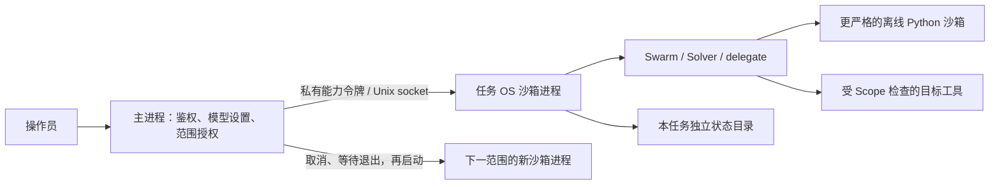

# 整任务进程隔离与两小时验证

## 已实现的边界

独立评估入口 `--engagement` 默认通过监督进程运行，不再直接在控制台进程中启动 Swarm。命令行用法保持一致，不提供启动失败后的宿主裸跑回退。



- 主进程持有全局状态写锁、公开控制台令牌、操作员模型设置和 Scope 授权。子进程不接收公开控制台令牌，也不读取宿主 `.env`、用户主目录或其他任务状态。
- 子进程以独立 PID 和进程组运行，环境从空白名单构造；仅通过 stdin 接收有大小上限的显式配置，凭证不放在命令行参数。显式 models-file 模式只传本任务选中的模型配置，不再附带未使用的控制台模型配置。
- 每个范围代次拥有 `STATE_DIR/capsules/<随机 ID>/`。macOS 使用默认拒绝的 Seatbelt profile；Linux 使用 bubblewrap 用户、PID、UTS、IPC 命名空间与只读运行时挂载。私有状态目录可写，宿主项目、用户凭证和兄弟任务目录不可读写。
- Node、MCP CLI 和 Playwright 浏览器缓存只按操作员选定的运行时路径只读授予，不继承整个 HOME、npm 配置或浏览器用户配置。内层浏览器与整任务沙箱的兼容性依赖具体运行时；本轮真实长测禁用浏览器，不能据此宣称浏览器链路也已验证。
- 子进程只在自己的目录内建立私有 Unix 控制套接字。主进程用另一个能力令牌访问它。公开 API 仍先通过主进程身份、Host/Origin 和 CSRF 检查；内部请求不携带公开会话。子进程的内部服务不实现 ScopeController，不能通过它扩大授权。
- 范围切换先向旧进程组发送 SIGTERM，等待最多 10 秒收尾，必要时 SIGKILL 并等待回收，再启动新范围的进程。旧活动、会话、黑板、预算和报告不复制到新任务。
- 任务正常结束或崩溃后，Web 控制台继续存活。崩溃显示为失败，操作员可以显式保存范围启动新任务；不会静默重放未知网络动作。无 Web 的独立评估继续以退出码报告失败。
- 主进程只读聚合各隔离目录的历史记录，兼容既有根目录历史。首次升级读取旧操作员 Scope，避免退回更宽的 JSON 示例范围；旧会话不自动复制进新沙箱，旧证据仍可查询。运行中的隔离目录、主进程 manifest 和旧数据均应保留。

模型的网络代理按已配置模型端点由主进程解析，再以显式配置传入；不会把整份宿主代理环境传给子进程。目标 HTTP/TCP 工具继续禁用代理。macOS 仅授予系统 DNS 查询及证书信任验证所需的系统服务，不放开用户 Keychain 文件。子进程日志最多保留 2 MiB。

## 尚不应作出的保证

这是完整评估任务的进程与文件访问隔离，并非 VM、多租户安全证明或内核漏洞防护。为了连接真实模型和授权目标，整任务层仍使用宿主网络；目标范围由 Go 工具与浏览器代理检查，**不是所有网络出口的内核白名单**。离线 Python 层继续禁止全部网络。

整任务尚无 cgroup 等聚合内存硬上限；长测的 RSS 阈值是观测性失败条件，不能当作操作系统强制限额。macOS 对极端资源耗尽仍需部署层容器/VM。测试的进程组取消不等于对任意蓄意脱离进程组程序的完整证明。

本轮默认隔离覆盖 `--engagement` 评估及其范围切换。TSecBench 平台调度器仍保留原执行路径，尚未把平台提交和调度凭证拆成独立任务代理；不要把本实现描述为所有运行模式均已完成隔离。

## 已完成的验证

- macOS 实际 OS 沙箱：主进程 canary 文件读取和兄弟路径写入被拒，私有目录可读写，宿主秘密环境变量不继承，私有 Unix socket 可用，取消可回收进程。
- 真实 CLI 黑盒测试：范围变更产生新 PID，旧 PID 已回收，历史跨目录可读；无效范围不会扰动当前任务；SIGKILL 任务后主进程仍可查询，并可显式启动替代进程；升级保留先前的操作员授权范围。
- 生产入口真实模型短预跑：`deepseek-flash`，11 次调用、67,235 token，独立复现与取消后的报告落盘通过，观测满 60 秒。早期 DNS/代理缺失导致的失败预跑已保留，不能记为通过。
- 普通单测默认跳过付费测试。Linux 后端已在 macOS 上交叉编译检查，已加入 Linux CI 的强制内核隔离测试；本机未运行 Linux 内核测试，不能把 CI 配置存在或环境跳过当作通过。

CLI 黑盒测试执行的是另行构建的生产二进制，不计入父测试进程的普通 Go 覆盖率；因此不能用 `cmd/chronos` 包的低覆盖率推断它未经过进程级验证，也不能声称此处已有完整的语句覆盖。

## 两小时真实模型周期负载（已完成）

冻结的测试二进制于 **2026-11-02 10:19:30 +0800** 启动，测试于 **12:19:31 +0800** 完成。实际观测 **7,200.016 秒**，每 600 秒执行一轮，**12/12 轮通过**，测试退出码为 **0**；`runner.json` 和 `soak-result.json` 均记录结束且通过。

使用一个持续存活的生产监督进程和测试进程自己的 loopback HTTP fixture。每轮通过鉴权控制台切换 Scope，检查旧任务退出及新 PID，调用真实模型，人工审批接口由测试程序逐次核验后批准 **精确 fixture URL 的 GET**，验证另一执行器的新流量与报告，随后取消任务、等待持久化完成，在空闲间隔继续观察主进程。

这是含空闲间隔的周期任务负载，不是连续模型满载测试，也不是外部生产靶场或完整浏览器链路测试。fixture 的公开合成标记不是真实漏洞。每次验证最多 600 次模型请求、累计 2,000,000 token；达到预算停止，不能为完成时长而悄悄追加。

| 核对项 | 实测结果 |
| --- | --- |
| 持续监督进程 | 同一个主进程完成整个两小时周期，结束后已退出 |
| 完整任务轮次 | 12/12；每轮均存在另一执行器采集的新流量与独立验证 |
| 任务进程启动 | 13 次，含首次暂停配置用进程；12 个实际工作进程；均已回收 |
| 真实模型调用 | 136 次：118 次成功返回，18 次预定收尾取消，非预期供应商错误 0 次 |
| 已返回的 token 用量 | 801,303；取消请求未返回的供应商计费不由本地日志推断 |
| HTTP 审批与目标请求 | 51 次批准，50 次实际到达 fixture 并返回 200，1 次在收尾中取消；越界请求与拒绝记录 0 次 |
| 网络目标 | 唯一的进程自建 loopback fixture，精确 URL 的 GET |
| 主进程采样 RSS 最大值 | 13,400 KiB（约 13.1 MiB） |
| 任务进程采样 RSS 最大值 | 16,912 KiB（约 16.5 MiB）；仅本 HTTP 工作负载，不含浏览器/Python负载 |
| 落盘恢复复核 | 12 个工作目录的黑板与流量由原生 `LoadOrNew` 在私有副本中重新加载，独立新流量、图判决与三种报告均可读取 |
| 进程清理 | runner、测试进程、监督进程及 13 个记录的任务 PID 均不再存活；无本次运行可执行文件残留进程 |
| 临时凭证副本 | 临时 models 文件已删除；原始用户模型配置未修改 |

被测生产二进制 SHA-256：`eaa4c574a6c4bd03ab9172580a27adc835dd359db108582d6a6376c81b7e6743`。冻结副本保留在证据目录，后续源码或前端修改不自动继承此二进制的长测结论。

**对证据规则和数据质量的补充观察：** 本轮共留下 23 条合成发现记录，其中 13 条有符合复核条件的独立新流量，分布在全部 12 个工作目录。模型并发会生成重复记录；测试达到每轮首个独立验证链路后即取消，所以其余记录不应被描述为均已独立验证。一个验证记录同时引用了更早的上下文流量，复核时未把该旧引用算作新复现。另有 32 条 HTTP 尝试未显式保存 method，依照工具契约的默认 GET 及 fixture 仅接受 GET 的响应判定；原始记录未被改写。原生黑板会把验证引用并入 Finding 的累计引用集合，不能将该集合误当作最初发现时的引用集合。上述观察已写入独立复核文件，长测通过不代表发现质量、去重或证据标签已完美。

原始 `provider_errors=18` 字段统计所有非 `ok` 返回，包含预期取消，**不应解释为 18 次供应商故障**。逐条复核确认这 18 条均为 `cancelled / context cancelled`，离线复核另行记录成功、预期取消和非预期错误。

本机证据目录：

```text
dist/process-soak-2h-20261102/
  chronos                    # 实际被测生产二进制的冻结副本
  soak.test                  # 实际测试程序的冻结副本
  runner.json                # 测试 PID、实际退出码与最终状态
  test.log                   # 逐轮通过或失败记录
  evidence/soak-result.json  # 时长、轮数、调用、token、RSS、审批、二进制 SHA-256
  evidence/postrun-audit.json # 原生恢复、独立证据、用量与审批的离线交叉复核
  evidence/process-cleanup-audit.json # 13 次任务启动与全部相关进程回收检查
  evidence/state/capsules/   # 各代任务的活动、证据、模型用量与报告
```

只有 `runner.json` 和 `soak-result.json` 均结束且通过，实际时间和轮数满足要求，才算此负载通过。本次已完成最终交叉复核。离线审计入口不访问模型或目标，不改写原始证据：

```bash
CHRONOS_AUDIT_SOAK_DIR="$PWD/dist/process-soak-2h-20261102" \
GOTOOLCHAIN=local go test -v ./internal/e2e -run TestAuditCompletedProcessSoak -count=1
```

重新运行（先构建；输出目录必须不存在；会产生真实模型费用）：

```bash
go build -o dist/chronos-isolated ./cmd/chronos
go test -c -o dist/chronos-soak.test ./internal/e2e
python3 scripts/run_process_soak.py \
  --binary "$PWD/dist/chronos-isolated" \
  --test-binary "$PWD/dist/chronos-soak.test" \
  --profile-dir "$PWD/.chronos-state" \
  --output "$PWD/dist/process-soak-$(date +%s)" \
  --seconds 7200 --interval 600
```

runner 保留实际执行文件与退出码，macOS 上在任务期间使用 `caffeinate` 防止自动空闲睡眠。停止时向 `runner.json` 记录的 runner PID 发送 SIGTERM；中断不算通过，失败证据不能覆盖删除。测试程序读取本地既有模型配置，不在日志中输出 API key，也不会向其他人发送消息。
